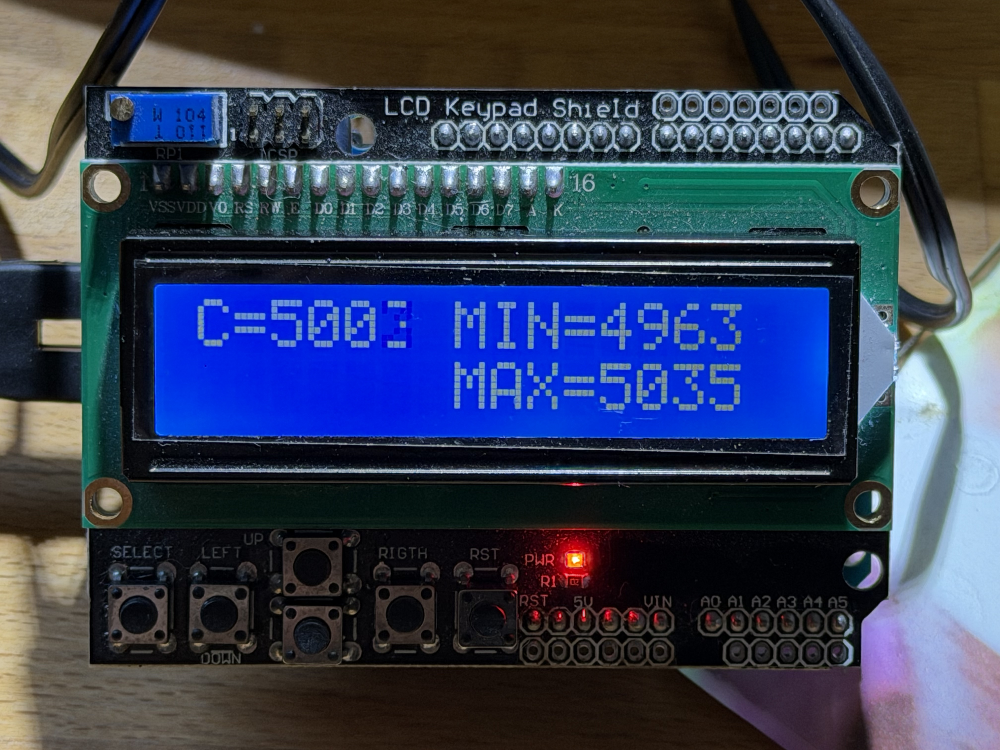
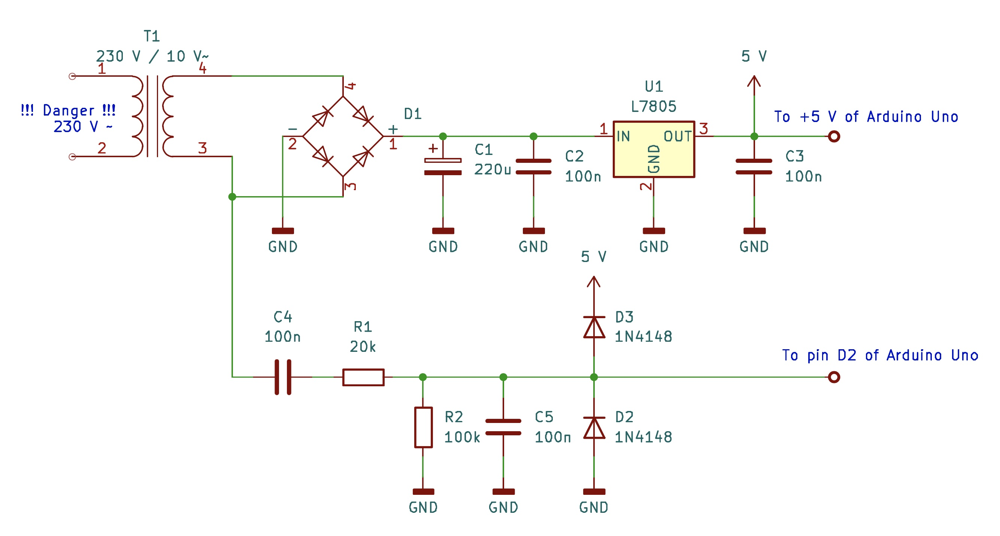
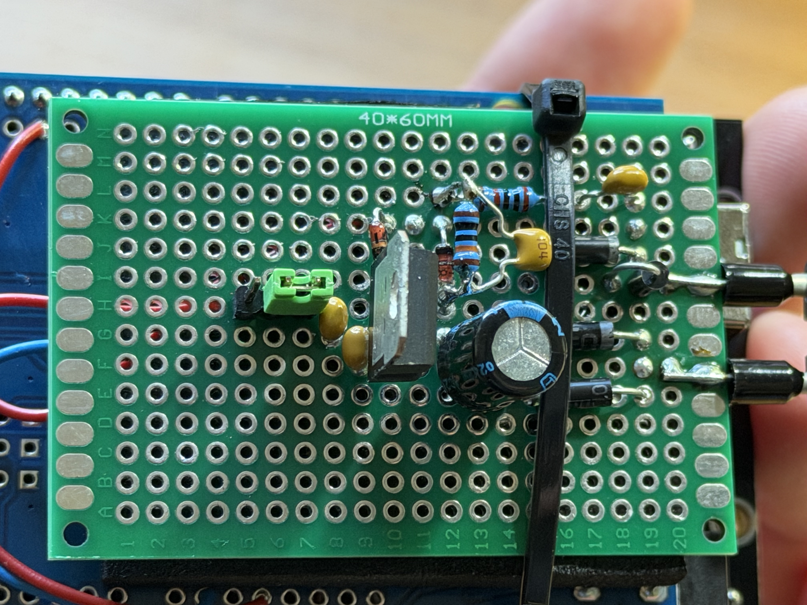

# A simple power line frequency monitor
Due to the "Energiewende", the European power grid's frequency got much more volatile, 
compared to one or two decades ago. In earlier times, the 50 Hz frequency could be 
considered as stable enough to directly drive clocks with synchronous motors from mains.
Doing something like this nowadays is a recipe for at least very bad time-keeping as
the frequency deviates quite considerably from the desired 50 Hz over the days. 

This little Arduino based project implements basically a reciprocal counter to determine
the duration of a single mains period. It requires an Arduino Uno, a cheap two line
LC-display, and a little circuit for powering the Arduino and deriving an interrupt 
signal based on the mains signal. 

Please note that this project is far from being "production ready". It is the result
of a lazy Sunday and serves merely as a proof-of-concept, and there is much to be 
desired (increase resolution to mHz, perform statistics such as average and variance,
maybe audible limit warnings, etc.). 

The basic idea is pretty straightforward: Using an small external circuit, an interrupt
signal is derived from the mains voltage. The interrupt routine reacting to this signal
computes the difference in microseconds since its last invocation, thus giving the 
period of the signal (please note that micros() only has a resolution of 4 microseconds,
thus the overall resolution is hundredth of Hz). This circuit looks like this:

This little circuit uses an external "wall wart"-type power supply yielding approximately
10V~ at its output. This is then rectified and stabilized at 5V to supply the Arduino Uno.
A second branch generates a clipped signal suitable as an external interrupt signal which
is connected to pin D2 on the Arduino Uno. (C5 is necessary to filter the signal a bit 
since it was otherwise way too sensitive to loads being connected and disconnected in the 
house - even switching on lights would result in spurious interrupts.)

Please make sure that you know what you are doing when you build something like this! 
Line voltage is deadly! Use some quality "wall wart"-type power supply for the transformer
so that you are never exposed to any power line voltage at all!

The implemented circuit looks like this:

The overall source code can be found in [pfmon.ino](pfmon.ino).
